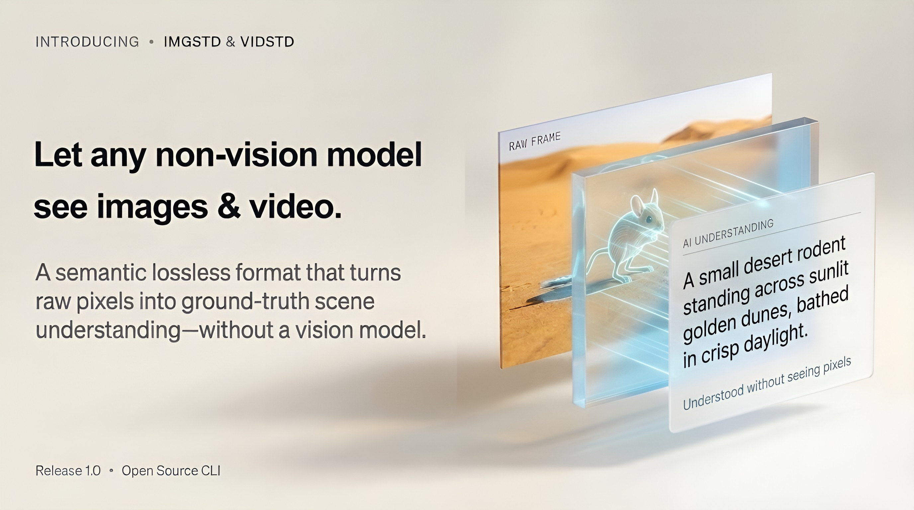
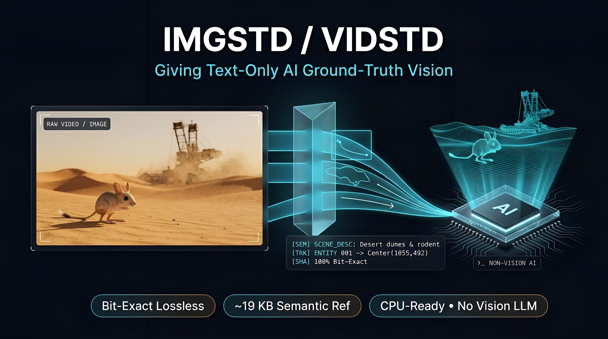
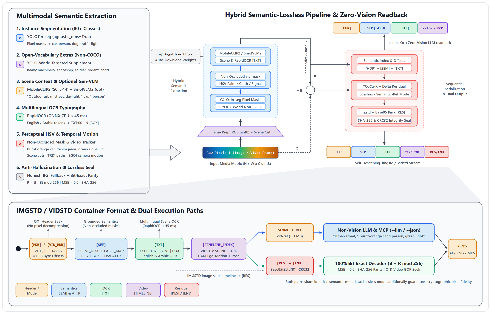

<div align="center">



# IMGSTD & VIDSTD (v1.0)

**Semantic-Lossless 8-bit Media Index & Non-Vision AI Reference CLI / MCP Toolkit**

[](https://github.com/ADEL-MAHMOUD10/VIDSTD/actions/workflows/ci.yml)
[](LICENSE)

</div>

`IMGSTD` & `VIDSTD` index 8-bit images and videos into self-describing UTF-8 **semantic containers** (`[HDR]`, `[SEM]`, `[TXT]`, `[TIMELINE_INDEX]`) readable by any text-only LLM in milliseconds via $\mathcal{O}(1)$ byte-offset seeking — while optionally storing a bit-exact `YCoCg-R + Delta + Zstd + Base85` residual (`MSE = 0.0`, SHA-256 verified) or emitting ultra-compact **Semantic Reference** files (`vid-ref`).

---

## Architecture Overview



### System Pipeline & Protocol Diagram



---

## Key Capabilities & Guarantees

- **Hybrid Instance Segmentation + Open-Vocabulary Architecture**:
  - `YOLO11n-seg` (`yolo11n-seg.pt`) for pixel segmentation masks and class-agnostic deduplication (`agnostic_nms=True`).
  - Targeted `YOLO-World` (`yolov8s-worldv2.pt`) non-overlapping supplement (`heavy machinery`, `spaceship`, `soldier`, `rodent`, `chart`, `diagram`).
  - Perceptual HSV color naming from non-occluded masks (`vis_mask`), upper/lower clothing split, and glowing traffic signal detection.
- **Strict 8-Bit Bit-Exact Lossless Integrity (`MSE = 0.0`)**:
  - Validates 8-bit (`uint8`) RGB/Gray/RGBA inputs cleanly (explicitly rejects 16-bit/float inputs rather than truncating silently).
  - Decoder enforces strict dimension limits (`<= 16384x16384`, `<= 64 MP`), exact `zstd` `max_output_size` decompression ceilings, and `label_id` range validation.
- **Sandboxed MCP Server (`imgstd-mcp`)**:
  - All file read/write tools enforce canonical containment under `IMGSTD_SANDBOX_ROOT` (defaulting to the launch working directory), blocking `../` path traversal and arbitrary file reads.
  - `SmolVLM2` loads strictly with `trust_remote_code=False` and never imports unverified code from `os.getcwd()`.
- **Configurable Scene & Generative Models (`MobileCLIP2` & `SmolVLM2`)**:
  - Choose from 6 `MobileCLIP2` tiers (`s0`, `s2`, `b`, `s3`, `s4`, `l-14`) plus optional `SmolVLM2-500M-Video-Instruct`.
  - **Auto-download on configure**: selecting models via `vidstd config set` or MCP `update_settings` caches weights cleanly on demand.

---

## Measured Benchmarks (CPU Reference)

Measured on Windows 11, 12-core x86_64 CPU-only (`PyTorch CPU`), comparing standard uncompressed raw buffer, PNG (`cv2.imwrite`), and full lossless `IMGSTD::V04` output:

| Workload | Resolution | Raw Size | PNG Size | IMGSTD Size | vs PNG | vs Raw | Encode Time | Inspect (`O(1)`) | Decode Time | MSE |
|---|---|---|---|---|---|---|---|---|---|---|
| Synthetic UI (`FastColorSegmenter`) | `256x256` | `196,608 B` | `1,156 B` | `962 B` | `0.83x` | `204.37x` | `6.81 s` (incl. cold CLIP load) | `11.38 ms` | `3.2 ms` | `0.0` |
| Street Photo (`Hybrid YOLO+CLIP+OCR`) | `1024x576` | `1,769,472 B` | `930,733 B` | `938,897 B` | `1.01x` | `1.885x` | `1.74–1.88 s` (cold ONNX CLI) | `0.40–1.20 ms` | `26.73 ms` | `0.0` |
| Noisy Gradient (`FastColorSegmenter`) | `1920x1080` | `6,220,800 B` | `3,708,949 B` | `5,111,602 B` | `1.38x` | `1.22x` | `352.1 ms` | `15.83 ms` | `139.2 ms` | `0.0` |
| Video Semantic Ref (`vid-ref`, 805f / 2.0 FPS) | `1920x1080` | — | — | `1.4 KB` | — | — | `5.34 s` (cold ONNX CLI, 2 I-frames + 73 P) | `~1 ms` | — | — |

> **Honest Storage Note**: Full pixel-lossless `.imgstd` embeds residuals as ASCII `Base85` (+25% text expansion) over Zstandard, so on high-entropy photos `.imgstd` is roughly `1.0x–1.38x` the size of a binary PNG. For videos you already keep locally, use **`vidstd vid-ref`** (`MODE:SEMANTIC_REF`), which strips pixel residuals and produces **`~1.4–20 KB`** AI reference timelines (`1.4 KB` observed for 805 frames @ 1080p).

---

## Quick Start (Fresh Clone)

### 1. Clone & Install

```bash
git clone https://github.com/ADEL-MAHMOUD10/VIDSTD.git
cd VIDSTD
python -m venv .venv
# Linux / macOS:
source .venv/bin/activate
# Windows PowerShell:
# .\.venv\Scripts\Activate.ps1

# Core CLI / Decoder / Inspector / OCR (lightweight, no PyTorch):
pip install -e . --no-build-isolation

# Full AI vision stack (YOLO11n-seg + YOLO-World + MobileCLIP2 + optional SmolVLM2):
pip install -r requirements.txt
pip install -e . --no-build-isolation --no-deps
```

Verify global CLI registration:

```bash
vidstd --version
vidstd --help
```

### 2. Initialize Models (One-Time Setup or Auto-Download on Demand)

Model weights are excluded from Git (`weights/` is gitignored) and downloaded cleanly on demand into `./weights` (or `~/.imgstd/weights` when installed outside a repo):

```bash
# Pre-download core vision models (YOLO11n-seg + YOLO-World + RapidOCR + active MobileCLIP2):
vidstd setup

# Or also select & download a specific MobileCLIP2 variant and/or SmolVLM2:
vidstd setup --model mobileclip2-s2 --smolvlm2
```

Even without `vidstd setup`, weights are **automatically downloaded** when you select a model in settings or run your first encode command.

---

## Choosing & Switching Models (Auto-Download on Configure)

```bash
# View all MobileCLIP2 tiers, SmolVLM2, local cache status, RAM/speed metrics & hardware tips:
vidstd models

# Switch active model (automatically downloads & builds prompt cache for that model):
vidstd config set --scene-model mobileclip2-s2

# Enable & automatically download SmolVLM2-500M-Video-Instruct (~1 GB):
vidstd config set --smolvlm2 on

# Save setting without downloading immediately:
vidstd config set --scene-model mobileclip2-b --no-download

# View current configuration or reset to lightweight CPU defaults:
vidstd config show
vidstd config reset
```

---

## Everyday CLI Usage

### Videos (`vid-ref`, `vid-inspect`, `vid-encode`, `vid-decode`)

```bash
# Build lightweight AI semantic reference (<1 MB, fast on CPU) from an existing video:
vidstd vid-ref "video.mp4" -o "video_ref.vidstd"

# Sub-millisecond context extraction for any text-only LLM:
vidstd vid-inspect "video_ref.vidstd" --llm
vidstd vid-inspect "video_ref.vidstd" --json

# Full bit-exact lossless compression & frame/video recovery:
vidstd vid-encode "clip.mp4" -o "clip.vidstd"
vidstd vid-decode "clip.vidstd" -o "clip_restored.mkv"
vidstd vid-frame "clip.vidstd" --frame 45 -o "frame45.png"
vidstd vid-roundtrip "clip.mp4"
```

### Images (`encode`, `inspect`, `decode`, `roundtrip`)

```bash
vidstd encode "photo.jpg" -o "photo.imgstd"
vidstd inspect "photo.imgstd" --llm
vidstd decode "photo.imgstd" -o "restored.png"
vidstd roundtrip "photo.jpg"
```

*(Note: `vidstd` and `imgstd` are identical aliases.)*

---

## MCP Server Integration (Sandboxed)

Start the sandboxed MCP server (restricts file read/write tools to `IMGSTD_SANDBOX_ROOT` or current directory):

```bash
# Linux / macOS:
IMGSTD_SANDBOX_ROOT="/path/to/allowed/media" imgstd-mcp
# Windows PowerShell:
$env:IMGSTD_SANDBOX_ROOT="D:\media_workspace"; imgstd-mcp
```

Example MCP client config (`claude_desktop_config.json` / `.mcp.json`):

```json
{
  "mcpServers": {
    "imgstd-vidstd": {
      "command": "imgstd-mcp",
      "env": {
        "IMGSTD_SANDBOX_ROOT": "/path/to/allowed/media"
      }
    }
  }
}
```

Key MCP tools exposed:
- `list_available_models`, `get_settings`, `update_settings` (with auto-download when switching models)
- `encode_image_to_imgstd`, `inspect_imgstd_code`, `query_region_at_point`, `recolor_imgstd_region`, `decode_imgstd_to_image`
- `encode_video_to_vidstd_tool`, `inspect_vidstd_timeline`, `query_vidstd_at_timestamp`, `extract_lossless_video_frame`, `get_vidstd_overview_tool`, `search_vidstd_timeline_tool`, `inspect_vidstd_timeframe_tool`

---

## Running Tests

```bash
pip install -e ".[dev]" --no-build-isolation
pytest tests/test_codec_and_security.py -v
```

---

## Additional Documentation & License

- [CLI & API Reference (English)](imgstd_project/COMMANDS_EN.md)
- [دليل الأوامر (العربية)](imgstd_project/COMMANDS.md)
- [Protocol Specification](imgstd_project/spec/protocol_spec.md)
- [AI Agent System Prompt](imgstd_project/server/AI_SYSTEM_PROMPT.md)
- [MIT License](LICENSE)
